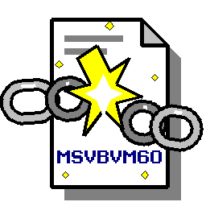
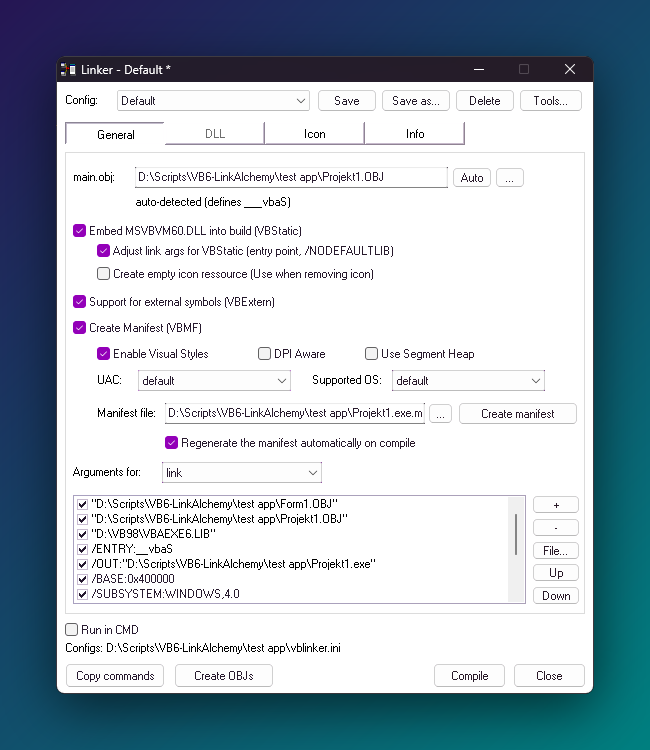

<p align="center">
  
</p>

<h1 align="center">VB6 LinkAlchemy</h1>

<p align="center">
  Standalone native Win32 EXEs and DLLs from Visual Basic 6, no <code>MSVBVM60.DLL</code> required.
</p>

<p align="center">
  
  
  
  
</p>

<p align="center">
  <a href="https://ultraalex00.github.io/VB6-LinkAlchemy/">Website</a> ·
  <a href="https://discord.com/invite/4wrdDCxq97">Discord</a> ·
  <a href="../../releases/latest">Download Setup</a> ·
  <a href="../../issues">Report a Bug</a> ·
</p>

---

## What is it?

LinkAlchemy lets you build **native Win32 apps in VB6** using a bit of linking voodoo.
Tick what you need, press **Compile**, and get a build that carries its own runtime, a manifest, a custom icon, or even native C code.



## Features

| | |
|---|---|
| **Direct replacement** | The Linker takes the place of `LINK.EXE`, so its window appears whenever VB6 creates an EXE or DLL. |
| **Embedded runtime** | **VBStatic** fuses `MSVBVM60.DLL` into your program. Nothing to install or register on the target PC. |
| **Call external symbols** | **VBExtern** turns marked `Declare` statements into linker externs, so you can link C objects and libs. |
| **Build DLLs** | ActiveX or Standard DLLs, with a choice of which functions to export. |
| **Embedded manifest** | **VBMF** writes an application manifest directly into `main.obj`. |
| **Custom icon** | **VBIcon** replaces the VB6 default icon with a multi-size set from a PNG, JPG, BMP or ICO, or removes it. |
| **Build configs** | Save named configs (e.g. debug and release) and switch between them from a list. |
| **Easy install** | An automated installer sets everything up. |

## Install

1. Download the setup program from the [latest release](../../releases/latest).
2. Run it. Everything you need is installed automatically.
3. In VB6, make your EXE or DLL as usual. The Linker opens by itself: check the options and press **Compile**.

Requires Windows and VB6 SP6.

## How a build runs

When you press **Compile**, the selected steps run in this order on the single `main.obj`:

```
VBExtern  →  VBIcon  →  VBStatic  →  VBMF  →  LINK2.EXE
```

1. **VBExtern** turns `<extern>` declarations into linker externs.
2. **VBIcon** replaces or removes the VB6 icon.
3. **VBStatic** fuses the VB runtime into the OBJ.
4. **VBMF** embeds the manifest.
5. **LINK2.EXE**, the real linker, produces your EXE or DLL.

The tools patch the OBJ in memory without temporary files and keep a pristine copy, so if a step fails the OBJ is restored and you can fix the problem and try again. Unselected steps are skipped.

## The tools

The Linker and the four patch tools are separate programs. Each patch tool also works from the command line.

| Tool | Purpose | Usage |
|---|---|---|
| **Linker** | The front end. VB6 starts it instead of `LINK.EXE`; it runs the other tools, then the real linker. | *(GUI)* |
| **VBStatic** | Embeds `MSVBVM60.DLL` into the main OBJ (EXE, ActiveX DLL or Standard DLL). | `VBStatic.exe msvbvm60.dll main.obj [/DLL:ACTIVEX \| /DLL:STANDARD] [/NOICON] [/OUT:file]` |
| **VBMF** | Embeds an application manifest as an `RT_MANIFEST` resource. | `VBMF.exe main.obj main.exe.manifest [/ID:n] [/OUT:file]` |
| **VBIcon** | Replaces or removes the default VB6 icon. | `VBIcon.exe main.obj icon.png [/RES:256,48,32] [/DEPTH:32,8,4] [/STRETCH] [/OUT:file]` |
| **VBExtern** | Rewrites `Declare` stubs into direct jumps to linker symbols. | `VBExtern.exe main.obj [/OUT:file] [/LIST] [/PLACEHOLDER:name] [/PREFIX:]` |

### Calling C code from VB6

Use the library name `<extern>` in a `Declare`:

```vb
Private Declare Function foo Lib "<extern>" Alias "bar" (ByVal a As Long, ByVal b As Long) As Long
```

This is equivalent to the C declaration:

```c
extern "C" int __attribute__((stdcall)) foo(int a, int b) asm("_bar");
```

The symbol is resolved against any OBJ or LIB you link in.

### Linking a VBStatic build

Linking needs no default libraries: `/NODEFAULTLIB` with entry `_VBStaticEntry` for an EXE, or `_VBStaticDllEntry@12` for a DLL. The Linker's **Adjust link args** option sets this for you.

## FAQ

**Does my program still need `MSVBVM60.DLL`?**
Not when you embed it. VBStatic fuses the runtime into your EXE or DLL.

**Why does a window open when I make my EXE?**
The Linker replaces `LINK.EXE`. VB6 starts it, it runs your selected tools, then hands over to `LINK2.EXE`.

**Why do my OBJ files disappear after a build?**
VB6 deletes them when it finishes. **Create OBJs** runs every step except the link and renames each OBJ to `name_sav.obj` so it stays on disk.

**Can I use the tools without the Linker?**
Yes. VBStatic, VBMF, VBIcon and VBExtern are standalone console programs.

More answers on the [project website](https://YOUR-USERNAME.github.io/REPO-NAME/#faq).

## Repository layout

| Folder | Contents |
|---|---|
| `link/` | The Linker Window |
| `vbstatic/`, `vbmf/`, `vbicon/`, `vbextern/` | The patch tools |
| `installer/` | NSIS installer script and assets |
| `docs/` | Project website (GitHub Pages) |

## License

[MIT](LICENSE)

---

<sub>VB6 LinkAlchemy is an independent project and is not affiliated with Microsoft. Visual Basic and Windows are trademarks of Microsoft Corporation.</sub>
